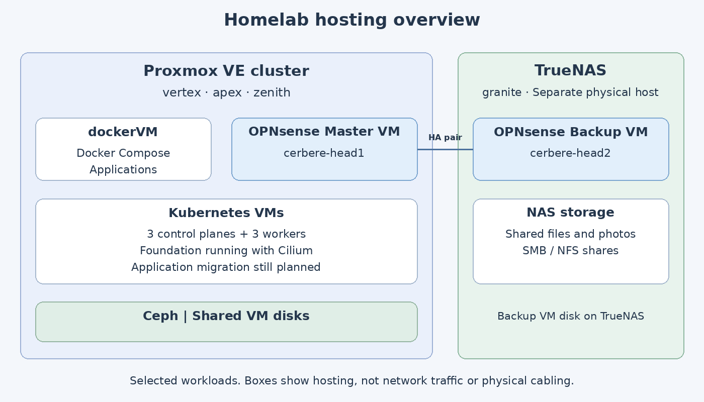

My homelab started in 2013 with the first Raspberry Pi. I wanted a cheap machine to learn Linux, and it became a basic NAS called Vezpibox. The name hasn't aged particularly well.

More Raspberry Pis followed, then a mini PC in 2019, when I started experimenting with virtualization and Docker at home. Eventually, that single server became a problem: it was both my playground and the machine keeping useful things running. Breaking a test environment is one thing. Taking the lights or the internet down with it is another.

Today, the lab has a three-node Proxmox cluster, distributed storage, a separate NAS and a redundant firewall pair. Most applications still run in Docker Compose. Kubernetes is running too, but moving the applications is the next part of the project, not something I've already finished.

*Last reviewed: October 2026.*

## A lab inside a cupboard

The original idea was to build a tiny datacenter in a closet. Space, noise, power consumption and budget all mattered, so the setup grew around compact machines rather than rack servers.

The rack is a DeskPi RackMate T1. It fits into the narrow enclosure, with shelves and a power strip to make use of the available space. With the door closed, the lab disappears into the apartment.

Cooling needed some attention too. During the original build, I added two 40 mm extraction fans above the cabinet, with PVC ducts and foam to limit vibration. Two 80 mm fans inside the rack and a PWM controller helped balance airflow and noise. In a cupboard in the middle of a living space, fitting the machines is only half the problem.

## The hardware

The three Proxmox nodes are different mini PCs:

| Node | Hardware | CPU | RAM |
| --- | --- | --- | --- |
| vertex | ASRock DeskMini A300 | Ryzen 3 2200G, 4 cores / 4 threads | 16 GB |
| apex | Minisforum HM50 | Ryzen 5 4500U, 6 cores / 6 threads | 32 GB |
| zenith | T-bao MN57 | Ryzen 7 5700U, 8 cores / 16 threads | 32 GB |

Each has a 256 GB SSD for the operating system, ISOs and templates, plus a 1 TB NVMe drive for Ceph. A 1 Gbps interface carries LAN and management traffic, and a separate 2.5 Gbps interface is dedicated to Ceph.

A fourth machine, `granite`, is a Beelink ME mini with an Intel N200 and 12 GB of RAM. It runs TrueNAS separately from the Proxmox cluster. That separation matters for more than storage.

## Platform

### Proxmox and Ceph

[Proxmox VE 9]() provides the virtualization layer across the three mini PCs. Ceph runs on the same physical nodes, using one NVMe drive per node and three-way replication over the dedicated 2.5 Gbps network. It provides shared VM storage and allows workloads to move between Proxmox nodes.

That is the foundation for the lab, but it does not make every application highly available. A VM can still fail internally, and an application can still break inside a perfectly healthy VM. Consumer NVMe drives and the storage network also put practical limits on performance.

### TrueNAS

[TrueNAS]() runs on `granite`, outside the Proxmox cluster. Its storage pool is a mirror of two 2 TB NVMe drives, with SMB file sharing and NFSv4 shares for application data. Nextcloud files and Immich photos live here rather than inside their containers.

This is a different storage job from Ceph: Ceph holds VM disks, while TrueNAS provides shared files and photos. The old NFS container on Vertex is gone. TrueNAS also hosts the [backup OPNsense VM](), with its disk on a zvol, keeping that firewall outside the Proxmox and Ceph failure domain.

### dockerVM

Most applications currently run on `dockerVM`, with [one Docker Compose stack per application](). Its VM disk lives on Ceph, while services that need shared data mount the relevant TrueNAS shares.

Docker remains the everyday application platform. It is also a concentration point: most services depend on this one VM, updates are still manual, and recovering an application is not the same thing as restarting its VM elsewhere in the cluster.

### Kubernetes

Kubernetes is the [intended replacement for the Compose application platform](). Its six VMs already run on Proxmox: three control-plane nodes and three workers, bootstrapped with kubeadm and connected with Cilium. [Terraform provisions the VMs and Ansible prepares them]() before the manual cluster bootstrap.

The foundation is running, but no applications have moved there yet. The Kubernetes Traefik gateway and cert-manager are still to be deployed, followed by storage and protection work before the gradual migration. GitOps comes later. The Traefik instance serving Docker applications today is a separate installation.

## Network

### UniFi for switching and Wi-Fi

The physical network uses a UniFi Switch Lite 16 PoE, a Flex Mini 2.5G dedicated to Ceph, and a U7 Pro Wall access point. The UniFi Network Application runs as a container on `dockerVM` and manages those devices.

[VLANs]() separate user devices, IoT equipment, the lab, the DMZ and management. There are also dedicated networks for the WAN, firewall synchronization, Proxmox heartbeat, Ceph and VPN access. UniFi carries the traffic; OPNsense decides what can cross between the routed segments.

### OPNsense for routing and firewalling

The [two firewall VMs]() are `cerbere-head1`, the Master on Proxmox, and `cerbere-head2`, the Backup on TrueNAS. CARP provides gateway redundancy, pfSync synchronizes connection state, and XMLRPC synchronizes configuration.

Hosting the Backup on TrueNAS means that taking the Proxmox or Ceph cluster down does not take both firewall VMs with it. This improves the firewall's resilience, without pretending that every switch, cable or other component is redundant too.

Dnsmasq provides DHCP and local naming. Unbound handles recursive DNS with Hagezi blocklists, and WireGuard provides remote access for my mobile devices.

[HAProxy runs on OPNsense]() and dispatches incoming HTTPS connections. Docker-hosted services go through Traefik on `dockerVM`; infrastructure interfaces use a separate HTTPS reverse-proxy branch on OPNsense. The OPNsense ACME plugin handles infrastructure certificate renewal on the primary firewall.

## Applications

The applications below still run on `dockerVM`. Some are services used at home, while others support the network, automation or the blog itself.

| Application | What I use it for |
| --- | --- |
| Home Assistant | Integrating connected devices and running home automation. |
| Node-RED | Visual automation flows alongside Home Assistant, including [Daikin AC control](). |
| InfluxDB | Storing historical Home Assistant data. |
| Nextcloud | File synchronization and collaboration, with its data on a TrueNAS share. |
| Immich | Managing photos and videos, with the photo library on TrueNAS. |
| Vaultwarden | Hosting a lightweight Bitwarden-compatible password manager. |
| Jellyfin | Serving the media library. |
| ARR stack | Automating media acquisition and organization with Sonarr, Radarr, Prowlarr and related tools. |
| Gitea | Hosting Git repositories and running CI/CD workflows with Gitea Actions. |
| Hugo blog | Generating this static website from Markdown in Obsidian, then serving it through Nginx. |
| Umami | Collecting web analytics for the blog. |
| Traefik | Routing requests to Docker applications behind OPNsense HAProxy and terminating their HTTPS connections. |
| UniFi Network Application | Managing the switches and Wi-Fi access point. |
| [Semaphore UI]() | Launching Ansible and Terraform automation from a web interface. |
| Portainer | Inspecting and managing the Docker containers, stacks and logs. |
| [Ntfy]() | Delivering push notifications from deployments, automation runs and media services. |

## Documentation with Obsidian

Obsidian is where I keep the lab's documentation. Projects, task logs, technical references and the infrastructure inventory live in the same vault, as local Markdown files versioned in Gitea. That gives me somewhere to record both what is running and how it got there, including the decisions and troubleshooting behind a change.

It is also where I write this blog. The articles start in the vault's `Blog/` folder, and [Gitea Actions and Hugo turn those notes into the site]() you are reading. Only the blog content is sent to the website; the project notes and inventory stay in the vault.

Obsidian itself runs locally, rather than as another service on `dockerVM`. Gitea hosts the vault repository, while Hugo generates the public website.

## Still a work in progress

The setup is more resilient than the original single server, but it still has obvious limits. Most applications depend on `dockerVM`, the NAS is a single host, and TrueNAS currently needs periodic restarts to work around unresolved memory growth. The firewall backup lives on that host, so the issue matters beyond file storage.

Those are part of the lab too. This page is the overview; the articles document how the pieces got here and what changes next.
