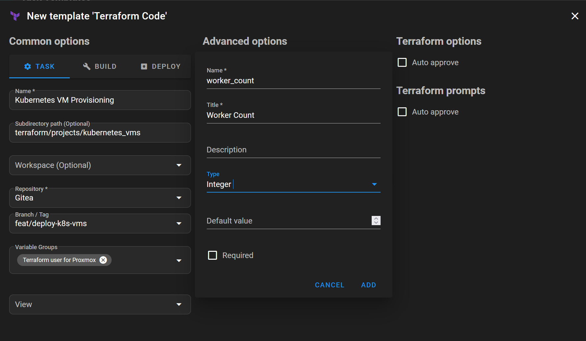
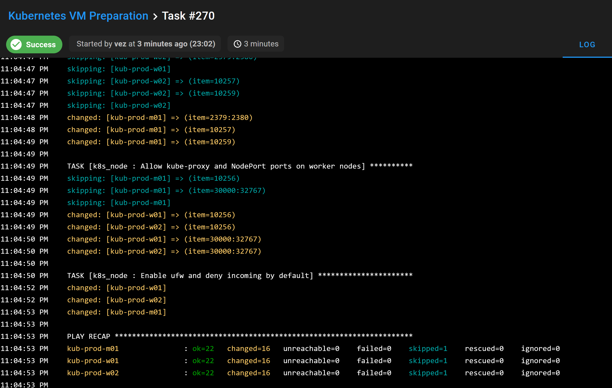

## Intro

Some months ago, I created six VMs in Proxmox to build my first Kubernetes cluster. Terraform created the machines, but I prepared the nodes manually, as described in [this previous article]().

That was intentional. I wanted to understand the preparation and bootstrap steps before putting them into automation.

ℹ️ Now I am working on the [migration from Docker Compose to Kubernetes](), and I want to automate the VM deployment and node preparation. The cluster bootstrap itself will remain manual for now, as planned in the roadmap.

The goal of this project is to end up with VMs ready for Kubernetes, using Terraform to create them and Ansible to configure them. I run both through Semaphore UI, with Terraform state providing the Ansible inventory.

## A dedicated Terraform project

I create a new Terraform project called `kubernetes_vms`, based on the work I already did on `terransible`. It reuses my existing `pve_vm` module, which I introduced in [this article]().

The earlier deployment created a master and a worker on each Proxmox node. This time, I use `master_count` and `worker_count` to define how many VMs I want for each role. The VM count no longer depends on deploying the same pair everywhere.

The naming convention also includes the environment and role: `kub-<env>-<role><digit>`. That makes the purpose of each VM easier to identify when looking at the Proxmox interface.

Placement uses the available RAM on the online Proxmox nodes. The control-plane VMs are spread across distinct hosts with enough free memory, while workers are placed according to the remaining capacity. This is placement during provisioning, not continuous rebalancing of running VMs.

Once the placement is calculated, the project passes each VM's attributes to the module:

```hcl
module "pve_vm" {
  source    = "../../modules/pve_vm"
  for_each  = local.vm_list
  node_name = each.value.node_name
  vm_name   = each.key
  vm_cpu    = each.value.vm_cpu
  vm_ram    = each.value.vm_ram
  vm_vlan   = each.value.vm_vlan
  vm_tags   = ["${var.vm_env}"]
}
```

✅ I first test the deployment from `bastion` with one master and two workers. It works as expected, so I move on to running it from Semaphore.

The complete [Terraform project](https://github.com/Vezpi/Homelab/tree/main/terraform/projects/kubernetes_vms) is available in my homelab repository.

## Choosing the deployment settings in Semaphore

I create a Semaphore task template for the Terraform project and expose its variables through a survey. After refactoring the inputs, I can choose the environment, along with the count, CPU, RAM, and VLAN for both masters and workers.



The project uses `vm_env` for the environment, with separate `master_*` and `worker_*` variables for the role settings. For example, `master_count` controls the number of control-plane VMs, while `worker_ram` sets the memory for workers.

There is a unit difference worth keeping in mind: the `master_ram` and `worker_ram` overrides use GiB, but the fallback values in `vm_attr` use MiB. Terraform converts the overrides to MiB internally before calculating placement and creating the VMs.

For the secret inputs, I use Semaphore environment variables. Terraform reads input variables from environment variables prefixed with `TF_VAR_`, so the Terraform variable `proxmox_api_token` is supplied as `TF_VAR_proxmox_api_token`.

I also need SSH credentials for this Semaphore setup, rather than the SSH key approach I used in the earlier `semaphore-vms` project.

✅ VM provisioning works from Semaphore. The next part is getting Ansible to target those VMs without maintaining a separate host list.

## Using Terraform state as Ansible inventory

Terraform already knows which machines it created. I want Ansible to use that information instead of copying the VM names and addresses into another inventory.

The Terraform project declares the inventory groups and hosts through the Ansible provider:

```hcl
resource "ansible_group" "vm_groups" {
  for_each = local.roles
  name     = each.key
}

resource "ansible_host" "vm_hosts" {
  for_each = module.pve_vm
  name     = each.key
  variables = {
    ansible_host = each.value.vm_ip
  }
  groups = [local.vm_list[each.key].vm_role]
}
```

Each host gets the IP address returned by the VM module and belongs to its role group, `master` or `worker`. These inventory resources are stored in Terraform state.

On the Ansible side, I use the `cloud.terraform` collection and its `terraform_provider` inventory plugin. The inventory configuration points to the Terraform project directory in Semaphore:

```yaml
---
plugin: cloud.terraform.terraform_provider
project_path:
  - /tmp/semaphore/project_1/repository_1_template_7/terraform/projects/kubernetes_vms
```

This path is specific to my Semaphore checkout. It is not a generic path to copy into another installation; a local execution needs to point to its own Terraform project directory.

I add `cloud.terraform` to `collections/requirements.yml` so Semaphore can install the collection. Before writing the node preparation role, I create a simple playbook that only runs an Ansible ping against the hosts.

✅ That test works. Semaphore can use the Terraform state to build the inventory and Ansible can reach the provisioned VMs.

⚠️ There is an important limitation, though: in this setup, `terraform.tfstate` lives inside the Semaphore container's temporary checkout. Recreating the container can lose that state. The inventory integration works, but it does not solve state persistence. Durable state storage still needs to be addressed before relying on this workflow for repeated rebuilds.

## Preparing the nodes with Ansible

With the inventory working, I create the `k8s_node` role and a small `k8s_node.yml` playbook that applies it:

```yaml
---
- name: Prepare Kubernetes nodes
  hosts: all

  roles:
    - role: k8s_node
```

The role is split into task files for system settings, packages, containerd, and the firewall.

The system tasks disable swap at runtime and attempt to comment out swap entries in `/etc/fstab`. They load and persist the `overlay` and `br_netfilter` kernel modules, then configure the bridge filtering and IPv4 forwarding settings.

The package tasks add the Kubernetes package repository, install `kubelet` and `kubeadm`, and put those packages on hold. The containerd tasks install the runtime, generate its configuration when it is missing, enable `SystemdCgroup`, and restart and enable the service.

⚠️ For the firewall, the role applies UFW rules according to the inventory groups. Control-plane nodes receive the control-plane rules, while workers receive the worker rules. The source subnet is configurable, and incoming traffic is denied by default. These rules need to match the network used by the nodes; they are not a universal firewall configuration for every cluster.

The Terraform groups are useful here beyond just listing the machines. Ansible can distinguish the node roles without another manually maintained mapping.

I create a Semaphore task template called **Kubernetes VM Preparation** to run the playbook with that inventory.



The [Ansible project and role](https://github.com/Vezpi/Homelab/tree/main/ansible/kubernetes) are also available in the repository.

## Where I stop for now

Selecting an environment in the survey works, but the current method does not let me manage multiple environments independently. Changing the environment input is not the same as giving each environment its own Terraform state.

Terraform workspaces might be a solution later. I have not implemented or tested that approach in this project, so for now the workflow remains limited to one environment at a time.

I also stop the automation before cluster bootstrap. The playbook prepares the nodes; it does not run `kubeadm init` or `kubeadm join`, and it does not install the CNI. Those steps remain manual for this stage of the migration.

✅ At the end of the project, I deploy six VMs with Terraform and configure them with Ansible. They are ready for cluster creation, but there is no bootstrapped Kubernetes cluster yet.

## Conclusion

🎯 I now have six VMs deployed with Terraform and prepared with Ansible through Semaphore. Using Terraform state as inventory means I do not need to copy their names, addresses, and roles into a separate host list.

The temporary state storage and lack of independent environments still need work. For now, I stop here with the prepared machines and move on to the manual Kubernetes bootstrap, as planned in the migration roadmap.
