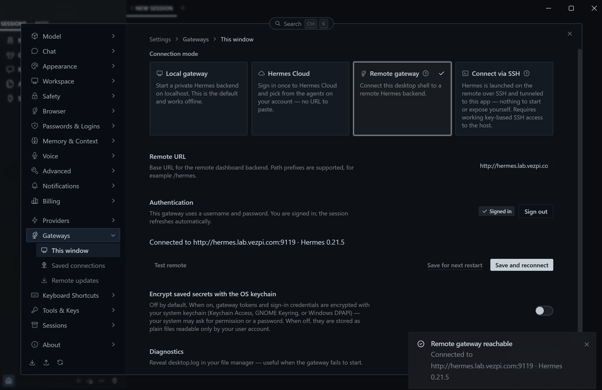
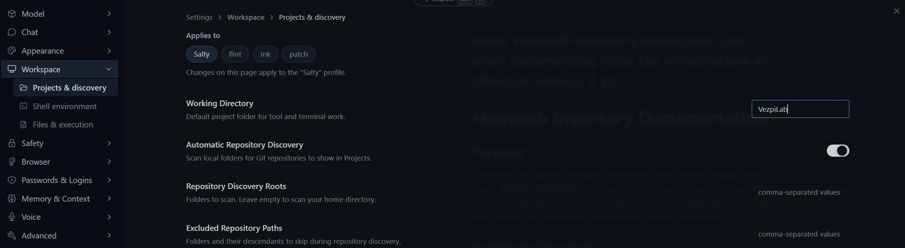
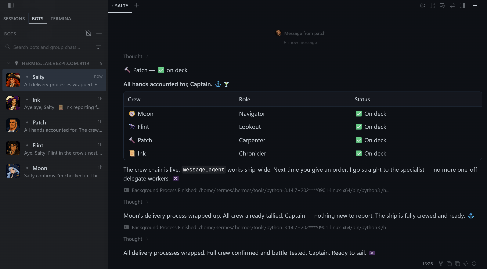
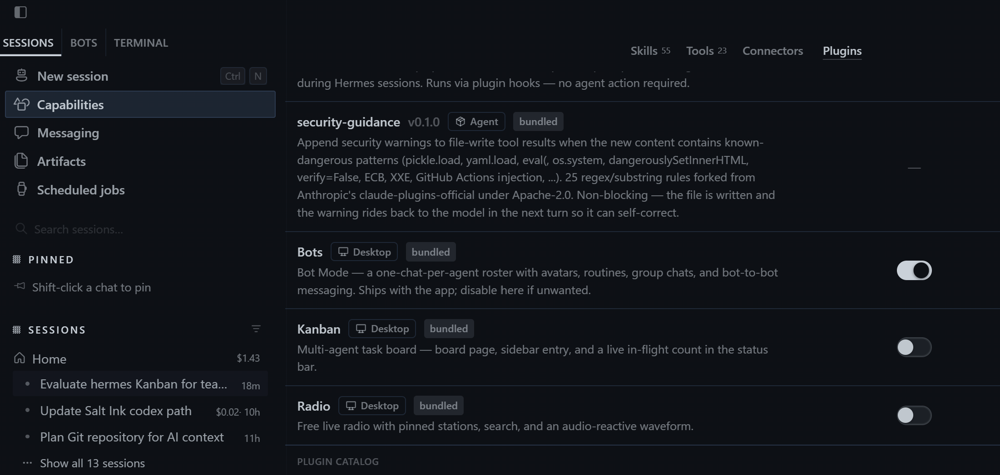
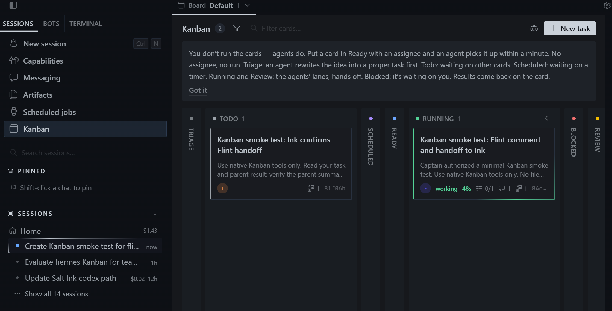
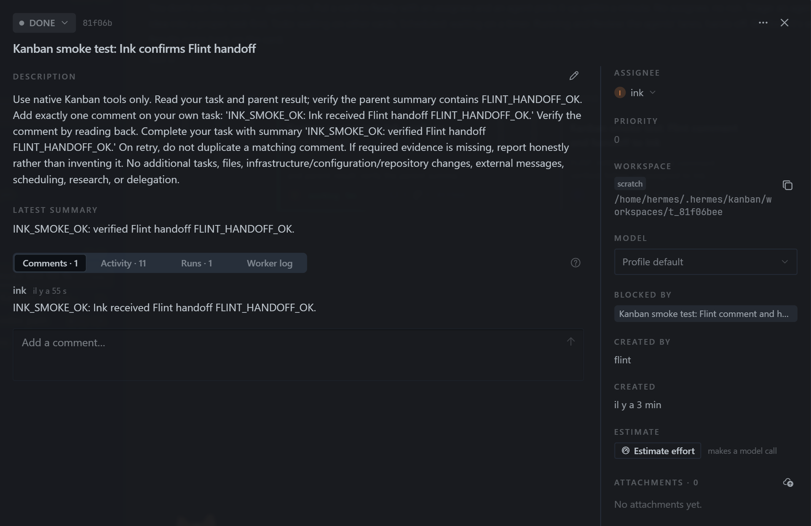
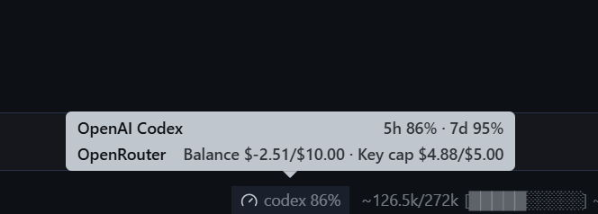

## Introduction

J'entends parler des agents IA autonomes depuis un moment. OpenClaw faisait beaucoup parler de lui, mais je ne voyais pas vraiment ce que j'en ferais. Après avoir un peu expérimenté avec les agents IA, j'ai commencé à comprendre comment ils pourraient m'aider dans mes propres projets.

Mon homelab me donne déjà pas mal de matière : du code d'infrastructure, des notes de projet et de la documentation technique. Je veux un assistant capable d'utiliser ce contexte, plutôt que de devoir lui réexpliquer toute la configuration à chaque conversation.

Je veux aussi expérimenter avec plusieurs agents qui travaillent ensemble. Est-ce que je peux leur attribuer des responsabilités distinctes et faire passer le travail de l'un à l'autre sans devenir celui qui copie les informations entre les chats ? Automatiser le travail pour finir au service copier-coller serait une promotion un peu décevante. 😅

🎯 Pour ce projet, je déploie Hermes Agent dans une VM Proxmox dédiée, je le connecte à mon coffre Obsidian et je constitue une petite équipe d'agents spécialisés. L'installation est la partie facile. Les faire travailler ensemble demande un peu plus de réflexion.

## Qu'est-ce que Hermes Agent ?

[Hermes Agent](https://hermes-agent.nousresearch.com/docs/) est un agent IA open source développé par Nous Research. Il relie un modèle de langage à des outils, une mémoire persistante et des instructions réutilisables appelées skills.

Hermes n'est pas le modèle lui-même. Le modèle interprète ma demande et décide de la prochaine action. Hermes fournit l'environnement dans lequel il peut agir. Selon les outils que j'active, cela peut inclure la lecture de fichiers, la modification de Markdown, la recherche sur le web ou l'exécution de commandes.

Un agent peut donc enchaîner plusieurs étapes avant de me répondre. Il lit les fichiers pertinents, appelle un outil, examine le résultat et continue s'il reste du travail. C'est la boucle de l'agent. Son utilité dépend du contexte, des permissions et des outils dont il dispose, ainsi que du modèle qui le fait fonctionner.

Deux fonctionnalités m'intéressent particulièrement :

- La mémoire persistante conserve le contexte utile entre les sessions, comme mes préférences et des informations sur mon environnement.
- Les skills stockent des procédures que l'agent peut charger lorsqu'une tâche en a besoin. Hermes peut créer et affiner ces skills à partir de son expérience.

💡 La partie auto-amélioration mérite une petite explication. Enregistrer une procédure n'est pas la même chose qu'entraîner le modèle sous-jacent. L'agent consigne quelque chose de réutilisable, puis le consulte lors d'une prochaine session. Je peux examiner ces instructions et les corriger si nécessaire.

Hermes propose aussi une application desktop et des passerelles de messagerie. Je peux interagir avec la même installation distante depuis mon portable ou via Telegram sur mon téléphone.

## Hermes sur Proxmox

🚀 Je crée une VM Ubuntu à partir de mon [template cloud-init existant](), avec les ressources suivantes :

| Ressource | Configuration |
| --- | --- |
| Nom d'hôte | `hermes` |
| CPU | 2 vCPU |
| Mémoire | 4 GB |
| Disque | 30 GB |
| Réseau | VLAN Lab |

J'utilise un utilisateur Linux dédié nommé `hermes` pour exécuter l'agent. Après avoir installé les prérequis, je passe sur cet utilisateur et lance l'installateur :

```bash
sudo apt update
sudo apt install git curl xz-utils libatomic1
sudo -iu hermes
curl -fsSL https://hermes-agent.nousresearch.com/install.sh | bash
```

L'assistant de configuration me guide dans le choix du fournisseur de modèles et des outils. J'utilise d'abord OpenRouter, puis je bascule mes profils vers l'intégration de l'abonnement OpenAI.

ℹ️ J'héberge ici l'environnement de l'agent, pas le modèle de langage. Dans ma configuration, les requêtes au modèle partent toujours vers un fournisseur externe. Exécuter Hermes dans ma propre VM ne signifie pas que le contexte envoyé à ce fournisseur reste dans le homelab.

Sur ma Surface, j'installe Hermes Desktop et je le connecte à la VM via les paramètres de passerelle distante. L'application me sert d'interface, tandis que l'agent travaille avec les fichiers de la VM.



J'exécute le backend du dashboard comme un service utilisateur `systemd` et j'active le lingering pour qu'il reste disponible après déconnexion.

Cela me donne une interface pratique pour discuter, suivre l'activité des outils et configurer les agents sans garder un terminal SSH ouvert.

## Connexion à Obsidian

Avant de demander à Hermes de m'aider avec le lab, je prépare du contexte sur mes objectifs, l'infrastructure et ma façon de travailler. Je lui demande ensuite de faire le point sur ce qu'il sait et de me poser des questions pour combler les lacunes.

🔎 Les questions sont plus pertinentes que prévu, et je prends le temps d'y répondre soigneusement. C'est aussi un bon moyen de découvrir les parties de ma configuration que je n'ai pas bien expliquées.

Mon coffre Obsidian est l'étape suivante. Il contient les notes de projet et la documentation technique que je veux voir l'agent consulter, plutôt que de se limiter à ce que je mentionne au fil d'un chat.

Je crée un compte Gitea dédié à Hermes et lui donne d'abord un accès en lecture au dépôt du coffre. L'agent clone le coffre sur la VM. Quand je suis prêt à le laisser pousser des modifications de documentation, je lui accorde l'accès en écriture.

L'accès aux fichiers n'est qu'une partie de la préparation. L'agent doit aussi savoir comment les utiliser. J'écris donc un Codex qui décrit la structure du coffre et ses règles de fonctionnement. Les journaux de projet lui donnent le contexte de mes expérimentations et de mes décisions.

Hermes commence à créer des skills à partir de ce contexte. C'est utile, mais je ne veux pas que chaque agent invente sa propre version de mon workflow. À mesure que la configuration évolue, je commence à maintenir les instructions partagées de façon plus délibérée.

## Rôles des agents

🏴‍☠️ Pour une raison qui m'échappe, je me fais déjà appeler Captain quand je parle aux assistants IA. Avec Docker et Kubernetes dans le lab, le thème nautique n'est pas complètement hors sujet. Je pousse l'idée un peu plus loin et crée un équipage pour Vezpi Lab.

Derrière les noms et les avatars, chaque membre a une responsabilité définie :

| Agent | Responsabilité |
| --- | --- |
| Salty | Architecture, planification, délégation et revue |
| Flint | Recherche et vérification auprès de sources externes |
| Patch | Développement logiciel et infrastructure, tests et investigations en lecture seule |
| Ink | Documentation, maintenance de la base de connaissances et traductions |

J'inclus au départ un autre agent pour l'architecture, puis je confie cette responsabilité à Salty. Quatre profils suffisent pour cette expérimentation. Mon homelab a maintenant un organigramme, ce qui est probablement le signe que je suis allé assez loin dans l'exercice de nommage. 😄

Un [profil Hermes](https://hermes-agent.nousresearch.com/docs/user-guide/profiles) possède sa propre configuration, sa mémoire, ses sessions et ses skills. Ce sont des environnements d'assistant distincts sur la même machine, pas quatre VM ni quatre modèles entraînés séparément.

Cette séparation me permet de donner un rôle plus ciblé à chaque agent. Ink a besoin de mes conventions de rédaction, tandis que Patch a besoin du code et du workflow de vérification. Flint n'a pas besoin de tous les outils utilisés pour maintenir le coffre.

⚠️ Je définis aussi des limites. Les agents peuvent faire des recherches, préparer du code, lancer des vérifications et documenter les résultats. Je reste responsable des décisions et de l'application des changements à l'infrastructure du homelab. Une description de rôle n'est toutefois pas une sandbox de sécurité. L'accès aux outils et les identifiants doivent rester cohérents avec ces responsabilités.

### Fichiers de contexte

Je répartis le contexte à plusieurs endroits :

| Fichier ou répertoire | Rôle dans ma configuration |
| --- | --- |
| `SOUL.md` | Identité, rôle et limites du profil |
| `USER.md` | Informations sur moi et mes préférences |
| `MEMORY.md` | Informations durables conservées entre les sessions |
| `AGENTS.md` | Règles partagées pour travailler dans le workspace Vezpi Lab |
| `skills/` | Procédures chargées pour des tâches spécifiques |

Les règles partagées du workspace renvoient les agents vers le Codex du coffre. Elles rendent aussi la répartition du travail explicite, pour que chaque profil ne cherche pas à tout faire. Je définis leur répertoire de travail sur le workspace Vezpi Lab.



Je déplace les identités et les skills personnalisés dans un dépôt Git dédié, avec un script de déploiement et une configuration de projet. Ces fichiers commençaient à s'éparpiller sur la VM, et je veux suivre leurs modifications comme le reste de ma configuration.

## Délégation entre agents

Créer les profils me donne des spécialistes, mais pas immédiatement une équipe utile.

🧩 Lors d'un premier test de délégation, Salty crée un sous-agent temporaire au lieu de contacter le membre de l'équipage auquel je pensais. Les deux approches peuvent être utiles, mais elles sont différentes. Donner à chacun un nom et un avatar ne suffit malheureusement pas à régler la délégation.

Un sous-agent temporaire démarre une nouvelle conversation pour une tâche délimitée. Mes profils nommés conservent leurs propres instructions et leur mémoire. Si je veux que Flint fasse la recherche selon son rôle, lancer un agent enfant générique n'est pas forcément la passation que je recherche.

J'expérimente avec Bot Mode et j'arrive à faire échanger les agents nommés dans l'application desktop.



📱 Je configure aussi Telegram pour chaque profil, ce qui me permet de parler à l'équipage depuis mon téléphone.

La passerelle tourne comme un service utilisateur. Après un redémarrage de la VM, je confirme qu'elle repart et que je peux de nouveau joindre les bots.

Malgré tout, maintenir plusieurs profils ajoute de la friction. J'envisage même de revenir à un seul assistant. Il me faut un moyen d'attribuer le travail et d'en conserver le résultat sans transférer moi-même le contexte d'une conversation à l'autre.

## Coordination avec Kanban

Le tableau Kanban est ce qui me convainc de conserver la configuration multi-agent.

Dans Hermes, c'est une file de travail partagée. Une carte a un agent assigné, une description du travail attendu et un résultat consigné. Les dépendances permettent à une tâche d'en attendre une autre, et le dispatcher démarre les tâches éligibles avec le profil assigné.

J'active le plugin Kanban dans Hermes Desktop :



🔧 Je vérifie ensuite que les outils Kanban sont activés pour les quatre profils. Activer le plugin ne suffit pas si le worker prévu ne peut pas utiliser ses outils.

Pour le premier test, je demande à Salty de créer une petite tâche pour Flint, suivie d'une tâche pour Ink. Flint laisse un commentaire et prépare la passation. Ink vérifie ensuite le résultat de la tâche parente et le confirme.



La dépendance est visible sur le tableau. La tâche d'Ink attend que Flint termine, au lieu de compter sur moi pour remarquer un message et le transférer. Je peux ouvrir les cartes pour consulter leurs instructions, commentaires et résultats.

✅ Les deux tâches se terminent, et Salty me rapporte le résultat. Ce n'est qu'un petit smoke test, mais il vérifie ce qui me manquait : le travail peut passer d'un profil nommé à l'autre via une file partagée.



Pour rendre les mêmes outils Kanban disponibles via Telegram, je les active pour cette plateforme sur chaque profil :

```bash
hermes tools enable kanban --platform telegram
hermes -p patch tools enable kanban --platform telegram
hermes -p ink tools enable kanban --platform telegram
hermes -p flint tools enable kanban --platform telegram
```

Cela donne aux agents un mécanisme de suivi du travail en complément du chat. Cela ne prouve pas que n'importe quel projet complexe peut tourner sans surveillance, et ne me dispense pas de relire les résultats. En revanche, je peux voir ce qui a été demandé, qui s'en est chargé et ce qui a été produit.

## Abonnement OpenAI

💸 Après quelques sessions, la consommation de tokens est plus élevée que prévu. Ajouter des profils implique aussi de maintenir leur contexte et de décider des outils et des skills dont chacun a besoin.

Je désactive les skills inutilisés selon le rôle de chaque agent, sans les restreindre au point de ne plus pouvoir découvrir ce dont ils ont besoin en pratique. Les skills sont chargés à la demande, mais sélectionner ceux qui sont pertinents aide tout de même à garder une configuration ciblée.

Une requête via OpenRouter me coûte environ 5 $ pendant mon test. Le résultat me plaît, mais cela suffit à me faire reconsidérer la façon dont je paie les modèles. L'équipage est peut-être virtuel, mais la facture est bien réelle. 😅

Avec une facturation par clé API, chaque échange supplémentaire augmente la consommation que je paie. Cela me fait hésiter à poursuivre la conversation, même pour dire à un agent qu'il a fait du bon travail ou lui expliquer ce qu'il doit améliorer. Payer pour dire "bon travail", c'est donner un prix à la politesse, au sens propre.

Cette hésitation freine la boucle d'auto-amélioration que je voulais essayer. Les retours donnent à l'agent du contexte utile sur ce qui a fonctionné et ce qui doit changer. Les corrections peuvent ensuite devenir des instructions dans un skill réutilisable, plutôt que quelque chose que je dois réexpliquer la fois suivante.

Je bascule les profils vers l'intégration de l'abonnement OpenAI via Hermes Desktop et teste les requêtes texte ainsi que la génération d'images.

🔁 Depuis ce changement, je ne retiens plus mes retours à cause du coût de chaque requête. Je dis aux agents quand leur travail est bon, et je prends le temps d'expliquer ce qui doit être amélioré. J'hésite moins à itérer, ce qui me permet de mieux profiter de la boucle d'auto-amélioration d'Hermes.

J'installe aussi un plugin provider-usage pour voir la consommation dans l'interface plutôt que de consulter sans cesse le site du fournisseur.



Cela change ma façon d'accéder aux modèles, mais ne rend pas leur utilisation illimitée ou gratuite. Je dois toujours surveiller la consommation et choisir un modèle adapté à chaque tâche.

## Conclusion

🎉 Hermes tourne maintenant dans une VM Proxmox, connecté à mon coffre Obsidian et accessible depuis mon portable et mon téléphone. Les agents ont des rôles distincts, et leurs instructions partagées ainsi que leurs skills personnalisés sont suivis dans Git.

La découverte la plus utile est la passation via Kanban. Au départ, les profils distincts ajoutent assez de friction pour que je remette leur intérêt en question. Une fois que les agents peuvent attribuer du travail, attendre les dépendances et consigner les résultats sur des cartes, cette organisation prend davantage de sens.

J'expérimente encore pour trouver le bon niveau de spécialisation. Pour l'instant, je garde les quatre agents : Salty coordonne, Flint fait les recherches, Patch s'occupe de l'ingénierie et Ink documente. Je reste responsable des décisions et des changements d'infrastructure, avec une trace plus claire du travail que les agents préparent pour moi.
