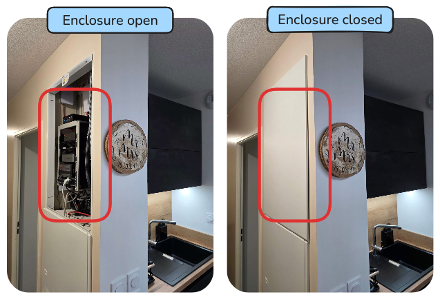
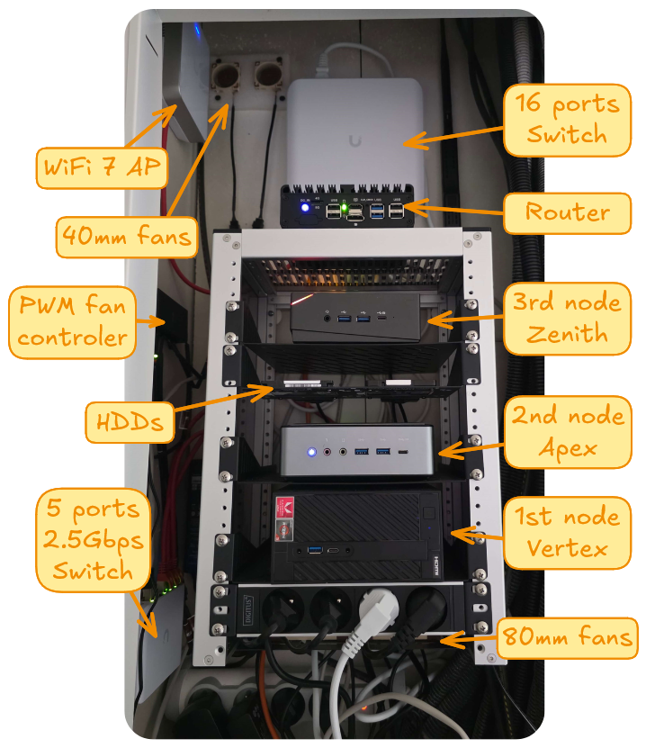
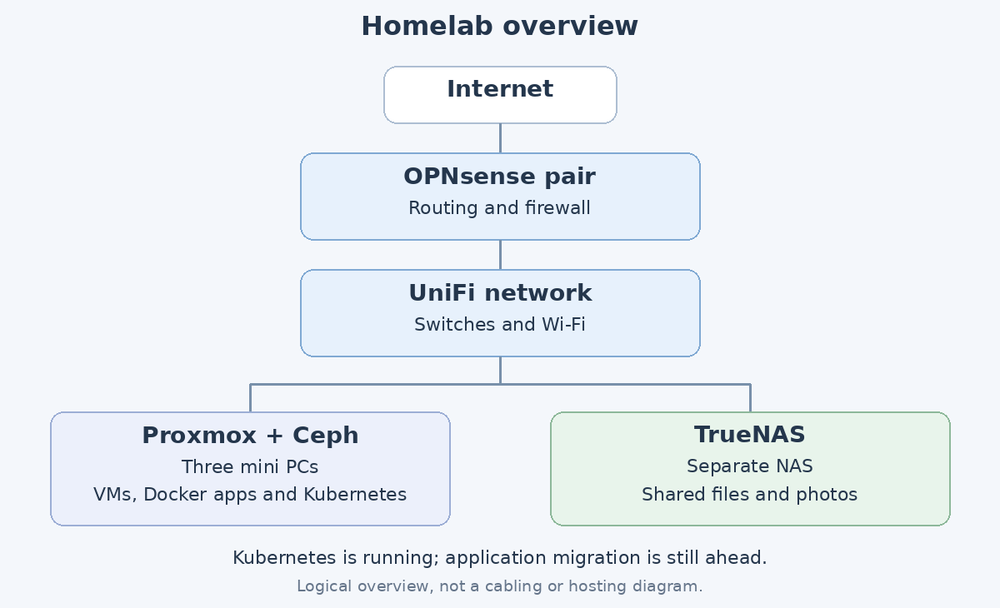

My homelab started in 2013 with the first Raspberry Pi. I wanted a cheap machine to learn Linux, and it became a basic NAS called Vezpibox. The name hasn't aged particularly well.

More Raspberry Pis followed, then a mini PC in 2019, when I started experimenting with virtualization and Docker at home. Eventually, that single server became a problem: it was both my playground and the machine keeping useful things running. Breaking a test environment is one thing. Taking the lights or the internet down with it is another.

Today, the lab has a three-node Proxmox cluster, distributed storage, a separate NAS and a redundant firewall pair. Most applications still run in Docker Compose. Kubernetes is running too, but moving the applications is the next part of the project, not something I've already finished.

This page describes the current setup. The articles go into the individual builds, migrations and occasional mistakes.

*Last reviewed: October 2026.*

## A lab inside a cupboard

The original idea was to build a tiny datacenter in a closet. Space, noise, power consumption and budget all mattered, so the setup grew around compact machines rather than rack servers.



The rack is a DeskPi RackMate T1. It fits into the narrow enclosure, with shelves and a power strip to make use of the available space. With the door closed, the lab disappears into the apartment.



Cooling needed some attention too. During the original build, I added two 40 mm extraction fans above the cabinet, with PVC ducts and foam to limit vibration. Two 80 mm fans inside the rack and a PWM controller helped balance airflow and noise. In a cupboard in the middle of a living space, fitting the machines is only half the problem.

## The lab at a glance



OPNsense handles routing and firewalling, UniFi provides switching and Wi-Fi, and the servers have two main jobs: Proxmox and Ceph host the VMs, while TrueNAS provides shared files and photos. The diagram deliberately leaves out individual VMs, network segments and application dependencies.

## The hardware

The three Proxmox nodes are different mini PCs:

| Node | Hardware | CPU | RAM |
| --- | --- | --- | --- |
| vertex | ASRock DeskMini A300 | Ryzen 3 2200G, 4 cores / 4 threads | 16 GB |
| apex | Minisforum HM50 | Ryzen 5 4500U, 6 cores / 6 threads | 32 GB |
| zenith | T-bao MN57 | Ryzen 7 5700U, 8 cores / 16 threads | 32 GB |

Each has a 256 GB SSD for the operating system, ISOs and templates, plus a 1 TB NVMe drive for Ceph. A 1 Gbps interface carries LAN and management traffic, and a separate 2.5 Gbps interface is dedicated to Ceph.

A fourth machine, `granite`, is a Beelink ME mini with an Intel N200 and 12 GB of RAM. It runs TrueNAS separately from the Proxmox cluster. That separation matters for more than storage.

## Proxmox and two different storage jobs

The cluster now runs Proxmox VE 9. It hosts the application VM, the primary firewall, the Kubernetes VMs and the Hermes Agent VM, along with LXC environments for administration and OpenCode.

Ceph runs on the same three physical nodes. Each contributes one NVMe drive, with three-way replication over the dedicated 2.5 Gbps network. It provides shared VM storage and supports migration between Proxmox nodes.

That does not make every application highly available. `dockerVM` is still one VM containing most of my services. A cluster underneath it does not remove failures inside that VM or its containers. Consumer NVMe drives and the storage network also put practical limits on performance, which remains a topic of investigation.

TrueNAS has a different role. Its storage pool is a mirror of two 2 TB NVMe drives. It provides SMB file sharing and NFSv4 shares, including Nextcloud data and Immich photos. Those shares are separate from the VM disks stored on Ceph.

The old NFS container on Vertex is gone. TrueNAS is now the NAS, but it is still a single machine, not another HA cluster. Replication, a mirror and snapshots also should not be confused with a complete offsite backup strategy.

## Keeping the network outside one failure domain

OPNsense no longer runs on the original dedicated firewall box. There are now two firewall VMs:

- `cerbere-head1`, the primary, runs on Proxmox with its disk on Ceph.
- `cerbere-head2`, the backup, runs on TrueNAS with its own zvol-backed disk.

CARP provides gateway redundancy, pfSync synchronizes connection state, and XMLRPC synchronizes configuration. Putting the backup on TrueNAS avoids losing both firewall VMs when the Proxmox or Ceph cluster is unavailable. It does not make the rest of the home network redundant.

The physical network uses a UniFi Switch Lite 16 PoE, a Flex Mini 2.5G for Ceph, and a U7 Pro Wall access point. The UniFi Network Application runs as a Docker container on `dockerVM`, not as an OPNsense plugin.

The network is split into management, user, IoT, DMZ and lab segments, with additional networks for WAN, firewall synchronization, Proxmox heartbeat, Ceph and VPN access. OPNsense handles routing and firewall policy. Dnsmasq provides DHCP and local naming, while Unbound handles recursive DNS and Hagezi blocklists. WireGuard provides remote access for my mobile devices.

### From HAProxy to the applications

HAProxy has replaced Caddy on OPNsense. For Docker-hosted HTTPS services, the main path is:

```text
HTTPS request → OPNsense HAProxy → Traefik on dockerVM → application
```

HAProxy dispatches HTTPS connections using SNI. Infrastructure services use a separate HTTPS reverse-proxy branch on OPNsense; they do not all pass through Docker's Traefik.

The OPNsense ACME plugin handles infrastructure certificate renewal. Its renewal job runs only on the primary firewall, so synchronized proxy configuration is not the same thing as redundant certificate renewal.

## What runs here

Most of the everyday services still use one Docker Compose stack per application on `dockerVM`.

| Purpose | Services |
| --- | --- |
| Home automation | Home Assistant, Node-RED and InfluxDB |
| Files, photos and passwords | Nextcloud, Immich and Vaultwarden |
| Media | Jellyfin and the ARR stack |
| Code and publishing | Gitea with Actions, this Hugo blog served by Nginx, and Umami |
| Administration | Semaphore UI, Portainer and the UniFi Network Application |
| Notifications | Ntfy |

The blog is part of the lab too. Its content starts as Markdown in my Obsidian vault, moves through Gitea Actions, and is built by Hugo. The result is served by Nginx on the same application VM.

AI tools have their own environments. Hermes Agent runs in a separate VM, with profiles for orchestration, research, engineering and writing. OpenCode CLI remains in an LXC. They help with the work around the lab; I remain responsible for applying infrastructure changes.

## Making it easier to rebuild

The `bastion` LXC is my administration environment, with SSH, Ansible, Terraform, OpenTofu, Helm and kubectl. Semaphore UI provides a web interface for automation runs.

Every week, Semaphore rebuilds the Ubuntu Noble cloud-init template and sends a notification through Ntfy. Terraform provisions the Kubernetes VMs, and Ansible prepares them before the manual kubeadm bootstrap.

Automation is not universal yet. Docker application updates remain manual, and rebuilding the entire lab from Git is still a goal rather than a capability I can claim today.

## Kubernetes is running, the migration is not done

The Kubernetes cluster has six VMs: three control-plane nodes and three workers. It was bootstrapped with kubeadm and uses Cilium. HAProxy balances access to the Kubernetes API, and BGP sessions connect the Cilium workers to OPNsense.

There are no application workloads on it yet. The Traefik gateway and cert-manager are still to be deployed. The Traefik instance serving Docker applications is a different installation, and Ceph backing the VM disks does not mean Kubernetes already has a Ceph storage class.

The plan is to validate the gateway and certificates, define storage and protection, then migrate applications progressively. GitOps comes later. Moving everything at once would defeat the point of keeping a useful home environment alongside a place to experiment.

## Still a work in progress

The setup is more resilient than the original single server, but it still has obvious limits. Most applications depend on `dockerVM`, the NAS is a single host, and TrueNAS currently needs periodic restarts to work around unresolved memory growth. The firewall backup lives on that host, so the issue matters beyond file storage.

Those are part of the lab too. This page is the overview; the articles document how the pieces got here and what changes next.

## The builds behind this page

- [Building the TrueNAS server]()
- [Moving the backup OPNsense VM to TrueNAS]()
- [Replacing Caddy with HAProxy on OPNsense]()
- [Planning the Docker Compose to Kubernetes migration]()
