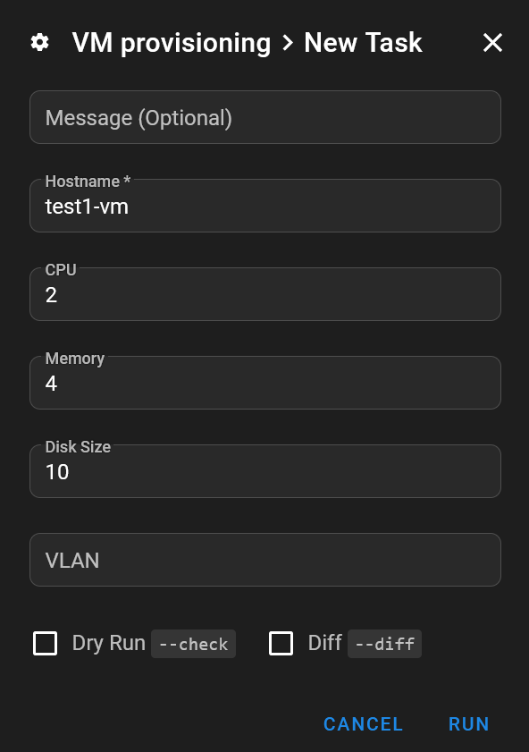

## Intro

Quand j'ai besoin d'une nouvelle VM dans Proxmox, j'ai déjà deux options. Je peux cloner mon template cloud-init depuis l'interface web, ou utiliser mon projet Terraform `simple-vm`.

Les deux fonctionnent, mais aucune ne convient vraiment à une VM jetable pour un proof of concept. L'interface web me laisse de la configuration manuelle à faire. Terraform gère ensuite le state de la machine, ce qui est utile pour une infrastructure que je veux maintenir, mais inutile dans ce cas précis.

💡 Je veux une troisième option : ouvrir Semaphore, saisir un hostname et quelques paramètres de ressources, puis lancer un playbook Ansible qui crée la VM et vérifie que le système invité est prêt.

L'approche est différente de celle de mon [déploiement de VM Kubernetes](), où Terraform crée un ensemble de machines et fournit l'inventaire à Ansible. Ici, je veux seulement provisionner une VM. Je ne demande pas au playbook de gérer toute sa vie ensuite.

📝 Le [playbook complet de provisioning des VM est disponible sur GitHub](https://github.com/Vezpi/Homelab/blob/main/ansible/proxmox/provision_vm.yml). Cet article explique comment il fonctionne et les points à prendre en compte pour l'adapter à un autre lab.

## Partir du template

Le playbook réutilise mon template cloud-init existant. J'ai déjà décrit [la création du template]() et [l'automatisation de sa reconstruction]() dans des articles précédents, je n'ai donc pas besoin de construire une image du système invité ici.

Pour ce workflow, le template possède un disque de démarrage sur `scsi0` et un lecteur cloud-init sur `scsi1`. Le système invité a aussi besoin de Python, de cloud-init, de SSH et de la commande `timeout`. La tâche de configuration du fuseau horaire utilise `timedatectl` et nécessite que l'utilisateur du système invité dispose des permissions sudo non interactives appropriées.

Je change le réseau du template pour `vlan66`, le réseau utilisé pour ces VM. Le playbook configure également le réseau de la VM clonée avant son premier démarrage.

Il y a deux plays :

- **Provisioning**: S'exécute localement sur le runner Ansible et utilise l'API Proxmox pour cloner, configurer et démarrer la VM.
- **Préparation du système invité**: Se connecte en SSH à la nouvelle VM, attend cloud-init et configure son fuseau horaire.

Cette séparation compte pour les identifiants. L'accès à l'API Proxmox ne donne pas à Ansible un accès SSH au système invité.

## Permissions API

Je crée un token API dédié, `semaphore@pve!provision_vm`, avec la séparation des privilèges activée. Je conserve l'utilisateur Semaphore existant plutôt que de créer un autre compte pour ce workflow.

Après avoir d'abord essayé des rôles personnalisés, j'utilise les rôles intégrés de Proxmox. Dans ma configuration, j'attribue les permissions suivantes à l'utilisateur et au token, avec la propagation activée :

- **`PVESDNUser`**: Sur `/sdn/zones/homelan`, pour le réseau SDN.
- **`PVEDatastoreUser`**: Sur `/storage/ceph-workload`, pour le stockage de destination.
- **`PVEVMAdmin`**: Sur `/vms`, pour les opérations sur les VM.
- **`PVETemplateUser`**: Sur `/vms/900`, pour le template source.

⚠️ Ce sont les permissions avec lesquelles mon workflow fonctionne, pas une garantie de permissions minimales. En particulier, `PVEVMAdmin` sur `/vms` a une portée large. Le stockage, la zone SDN, l'ID du template et le périmètre des permissions sont à revoir avant de réutiliser cela dans un autre environnement.

La validation du certificat de l'API reste activée. Le runner doit faire confiance à l'autorité de certification Proxmox plutôt que de contourner la vérification TLS.

## Paramètres Semaphore

Je crée un template de tâche Ansible qui pointe vers `ansible/proxmox/provision_vm.yml`, avec un inventaire localhost :

```ini
localhost ansible_connection=local
```

La collection Proxmox est fixée à `community.proxmox` version `2.0.0` dans le fichier `requirements.yml` adjacent. Le runner a également besoin des dépendances Python `proxmoxer` et `requests`.

Je conserve les paramètres fixes dans un groupe de variables Semaphore :

- **`proxmox_api_host`**: Le hostname de l'API, sans schéma d'URL.
- **`vm_template_id`**: Le VMID du template source.
- **`vm_storage`**: Le stockage de destination.
- **`vm_user`**: L'utilisateur cloud-init du système invité.
- **`vm_ssh_public_key`**: La clé SSH publique autorisée, ou plusieurs clés publiques complètes séparées par des retours à la ligne.

L'identifiant complet du token, `proxmox_api_token_id`, et son secret, `proxmox_api_token_secret`, vont dans l'onglet Secrets du groupe de variables. Ils n'ont leur place ni dans le survey ni dans le dépôt.

Le survey expose les paramètres que je veux choisir pour chaque VM :

- **`vm_hostname`**: Un hostname court, obligatoire et unique.
- **`vm_cpu`**: Le nombre de cœurs CPU, avec `1` par défaut.
- **`vm_ram_gib`**: La mémoire en GiB, avec `2` par défaut.
- **`vm_disk_gib`**: La taille absolue souhaitée du disque en GiB, avec `4` par défaut.
- **`vm_vlan`**: Le nom du bridge ou du VNet Proxmox, avec `vlan66` par défaut.



ℹ️ Malgré son nom, `vm_vlan` contient un nom de bridge ou de VNet, pas un tag VLAN numérique. La valeur du disque est la taille cible, pas une capacité supplémentaire à ajouter. Elle doit convenir au disque existant du template, puisque ce workflow est prévu pour l'agrandir, pas pour le réduire.

## Cloner avant de démarrer

Avant de créer quoi que ce soit, le playbook valide le hostname et la correspondance entre son réseau et son domaine DNS. Il vérifie ensuite dans le cluster si une VM porte déjà le nom demandé et s'arrête s'il en trouve une.

C'est volontairement une opération ponctuelle. Relancer le playbook avec le même hostname ne met pas à jour la VM existante.

Le playbook interroge également l'API pour découvrir le nœud actuel du template. Je ne fixe pas en dur un hôte source qui pourrait devenir incorrect après un déplacement du template.

Le clone complet utilise ce nœud découvert :

```yaml
- name: Clone template into a new VM
  community.proxmox.proxmox_kvm:
    clone: source-template
    vmid: "{{ vm_template_id }}"
    name: "{{ vm_hostname }}"
    node: "{{ source_vm.proxmox_vms[0].node }}"
    storage: "{{ vm_storage }}"
    full: true
    state: present
  register: cloned_vm
  no_log: true
```

Le VMID renvoyé identifie le nouveau système invité pour les opérations API restantes. Avant de tenter la configuration, le playbook vérifie que le clonage a signalé un changement et renvoyé un VMID différent de celui du template.

Il définit ensuite le CPU, la mémoire, le réseau, l'utilisateur cloud-init et les clés SSH autorisées. La mémoire est convertie de GiB en MiB pour le module Proxmox :

```yaml
cores: "{{ vm_cpu }}"
memory: "{{ vm_ram_gib | int * 1024 }}"
net:
  net0: "virtio,bridge={{ vm_vlan }}"
ipconfig:
  ipconfig0: "{{ vm_ipconfig0 }}"
ciuser: "{{ vm_user }}"
sshkeys: "{{ vm_ssh_public_key }}"
```

La tâche de configuration utilise `update_unsafe: true` pour remplacer `net0` sur la VM qui vient d'être clonée. Cela concerne ce nouveau système invité, ce n'est pas une invitation à appliquer des mises à jour réseau risquées à des machines existantes.

Enfin, le playbook redimensionne `scsi0` et démarre la VM. Le premier démarrage utilise donc les paramètres demandés.

## Trouver la VM

Ma configuration IP par défaut est `ip=dhcp`. Plutôt que de fournir une adresse manuellement, je me connecte à la VM par son nom de domaine pleinement qualifié.

Le playbook associe `vlan66` à `lab.vezpi.com` et déduit donc l'adresse du système invité à partir du hostname court et de ce suffixe. Les autres réseaux nécessitent leur propre correspondance. DHCP et DNS doivent publier le nom du système invité, et le runner doit pouvoir le résoudre.

Le playbook attend la résolution DNS, puis la disponibilité du port 22, avant d'ajouter le système invité à un inventaire en mémoire :

```yaml
- name: Add VM to dynamic inventory
  ansible.builtin.add_host:
    name: "{{ vm_hostname }}.{{ vm_dns_domains[vm_vlan] }}"
    groups: provisioned_vm
    ansible_connection: ssh
    ansible_user: "{{ vm_user }}"
    ansible_ssh_timeout: 10
    provisioned_vmid: "{{ cloned_vm.vmid }}"
```

Le second play cible `provisioned_vm`. Je n'ai pas besoin de maintenir une liste d'hôtes distincte pour cette exécution.

⚠️ Résoudre un nom ne prouve pas qu'il appartient à la nouvelle VM. Un enregistrement DNS obsolète peut pointer vers une autre machine. Vérifiez l'enregistrement et la clé d'hôte SSH du système invité par une procédure de confiance, et gardez la vérification des clés d'hôte activée.

## Attention aux clés SSH

La première VM se déploie, mais la connexion SSH échoue. J'ai collé la mauvaise clé publique dans le groupe de variables.

La VM a fait exactement ce que je lui ai demandé. Malheureusement, cela inclut la mauvaise clé. 😅

Je corrige la variable et provisionne une nouvelle VM. La connexion SSH fonctionne maintenant.

J'inclus ensuite plusieurs clés publiques, une par ligne, dont celle qui correspond à l'identifiant SSH de Semaphore. La clé privée reste dans le Key Store de Semaphore, et je sélectionne l'identifiant SSH existant sur l'inventaire de la tâche pour qu'il soit disponible quand Ansible se connecte au système invité ajouté dynamiquement.

C'est distinct du token API. Les deux parties doivent fonctionner pour que l'exécution complète du provisioning réussisse.

## Attendre cloud-init

Un port SSH ouvert n'est qu'une étape pour vérifier que la VM est prête. Le second play attend une connexion Ansible, puis attend cloud-init avec une limite de temps externe :

```yaml
- name: Wait for cloud-init status
  ansible.builtin.command: timeout 300 cloud-init status --wait --long
  register: cloudinit_wait
  changed_when: false
  failed_when: false
```

Ici, `failed_when: false` permet aux tâches suivantes d'examiner le résultat. Cela ne signifie pas que tous les résultats de cloud-init sont acceptables.

L'assertion de fin exige à la fois un code de retour accepté et `status: done` dans la sortie. Le code de retour `0` est accepté. Le code de retour `2` l'est aussi, mais produit un avertissement, car il indique une fin d'exécution en état dégradé.

Pendant mes tests, la cause signalée de cet état dégradé est la chaîne `user` dépréciée de Proxmox, plutôt qu'un échec de création de l'utilisateur SSH. Cela explique le résultat dans ce cas précis, mais ce n'est pas une raison pour ignorer tous les futurs codes de retour `2`. Les diagnostics détaillés restent à examiner.

Les dépassements de délai, les autres codes de retour et un état incomplet font échouer la vérification. La VM reste disponible pour inspection plutôt que d'être supprimée automatiquement.

## Fuseau horaire et résultat

Après avoir accepté la fin d'exécution de cloud-init, je définis le fuseau horaire du système invité sur `Europe/Paris` avec sudo. Cela permet l'affichage de l'heure locale avec les changements CET/CEST, sans modifier le RTC qui reste en UTC ni toucher à la configuration NTP.

J'ajoute d'abord davantage de vérifications, dont une lecture séparée du fuseau horaire et un ping Ansible final. Je simplifie ensuite le playbook tout en conservant les attentes limitées dans le temps pour le DNS, SSH, la connexion et cloud-init. La version actuelle définit directement le fuseau horaire et n'inclut pas ce ping final.

Je retire également du playbook de reconstruction du template la configuration qui imposait l'affichage sur console série, puis je reteste le provisioning avec l'affichage par défaut du template.

✅ Le workflow mis à jour fonctionne depuis Semaphore : il provisionne la VM, accède au système invité, accepte l'état terminé de cloud-init et applique le fuseau horaire.

## Conclusion

J'ai maintenant une troisième façon de créer une VM dans Proxmox. Pour un PoC jetable, je peux lancer la tâche Semaphore, choisir le hostname et les ressources, et laisser Ansible gérer le clonage et la préparation du système invité sans maintenir de state Terraform ensuite.

🔎 Je veux maintenant travailler sur le monitoring du homelab, avec des métriques historiques, des vérifications de santé et des alertes sur mes équipements, mon réseau et mes applications. Je prévois de comparer Zabbix et Checkmk Community avant de choisir une plateforme principale. Ces PoC me donnent un usage concret pour ce workflow de provisioning de VM.
