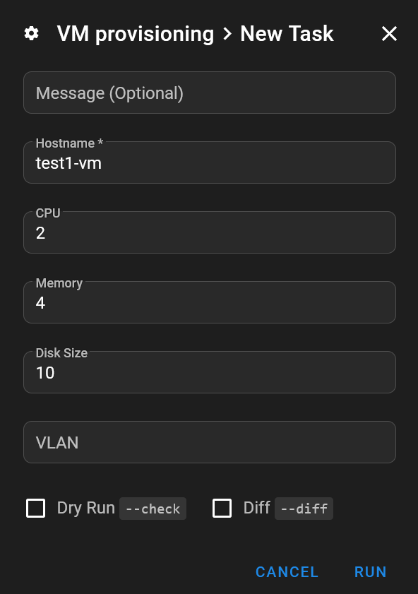

## Intro

When I need a new VM in Proxmox, I already have two options. I can clone my cloud-init template from the web interface, or use my Terraform `simple-vm` project.

Both work, but neither quite fits a disposable VM for a proof of concept. The web interface leaves me with manual configuration. Terraform manages the machine's state afterwards, which is useful for infrastructure I want to maintain, but unnecessary for this use case.

💡 I want a third option: open Semaphore, enter a hostname and a few resource settings, then launch an Ansible playbook that creates the VM and checks that the guest is ready.

This follows a different approach from my [Kubernetes VM deployment](), where Terraform creates a set of machines and provides Ansible's inventory. Here, I only want to provision one VM. I am not asking the playbook to manage its entire life afterwards.

📝 The complete [VM provisioning playbook is available on GitHub](https://github.com/Vezpi/Homelab/blob/main/ansible/proxmox/provision_vm.yml). The article focuses on how it fits together and the details that matter when adapting it to another lab.

## Start from the template

The playbook reuses my existing cloud-init template. I already describe [creating the template]() and [automating its rebuild]() in earlier articles, so I do not need to build a guest image here.

For this workflow, the template has a boot disk at `scsi0` and a cloud-init drive at `scsi1`. The guest also needs Python, cloud-init, SSH, and the `timeout` command. The timezone task uses `timedatectl` and requires the guest user to have the appropriate noninteractive sudo permissions.

I change the template's network to `vlan66`, which is the network used for these VMs. The playbook also configures the cloned VM's network before its first boot.

There are two plays:

- **Provisioning**: Runs locally on the Ansible runner and uses the Proxmox API to clone, configure, and start the VM.
- **Guest preparation**: Connects over SSH to the newly created VM, waits for cloud-init, and sets its timezone.

That separation matters for credentials. Access to the Proxmox API does not give Ansible SSH access inside the guest.

## API permissions

I create a dedicated `semaphore@pve!provision_vm` API token with privilege separation enabled. I keep the existing Semaphore user rather than creating another account for this workflow.

After initially trying custom roles, I use Proxmox's built-in roles. In my setup, I assign the following permissions to both the user and the token, with propagation enabled:

- **`PVESDNUser`**: At `/sdn/zones/homelan`, for the SDN network.
- **`PVEDatastoreUser`**: At `/storage/ceph-workload`, for the destination storage.
- **`PVEVMAdmin`**: At `/vms`, for VM operations.
- **`PVETemplateUser`**: At `/vms/900`, for the source template.

⚠️ These are my working permissions, not a claim of a minimal permission set. In particular, `PVEVMAdmin` at `/vms` has a broad scope. The storage, SDN zone, template ID, and permission boundaries need reviewing before reusing this in another environment.

API certificate validation stays enabled. The runner must trust the Proxmox certificate authority rather than bypassing TLS verification.

## Semaphore inputs

I create an Ansible task template pointing to `ansible/proxmox/provision_vm.yml`, with a localhost inventory:

```ini
localhost ansible_connection=local
```

The Proxmox collection is pinned to `community.proxmox` version `2.0.0` in the adjacent `requirements.yml`. The runner also needs the Python dependencies `proxmoxer` and `requests`.

I keep the fixed settings in a Semaphore variable group:

- **`proxmox_api_host`**: The API hostname, without a URL scheme.
- **`vm_template_id`**: The source template's VMID.
- **`vm_storage`**: The destination storage.
- **`vm_user`**: The cloud-init guest user.
- **`vm_ssh_public_key`**: The authorized public SSH key, or multiple complete public keys separated by newlines.

The full token identifier, `proxmox_api_token_id`, and its secret, `proxmox_api_token_secret`, go in the variable group's Secrets tab. They do not belong in the survey or the repository.

The survey exposes the settings I want to choose for each VM:

- **`vm_hostname`**: A required, unique short hostname.
- **`vm_cpu`**: CPU cores, defaulting to `1`.
- **`vm_ram_gib`**: Memory in GiB, defaulting to `2`.
- **`vm_disk_gib`**: The requested absolute disk size in GiB, defaulting to `4`.
- **`vm_vlan`**: The Proxmox bridge or VNet name, defaulting to `vlan66`.



ℹ️ Despite its name, `vm_vlan` contains a bridge or VNet name, not a numeric VLAN tag. The disk value is the target size, not extra capacity to add. It must be suitable for the template's existing disk, since this workflow is intended to grow it, not shrink it.

## Clone before booting

Before creating anything, the playbook validates the hostname and its network-to-DNS mapping. It then checks the cluster for an existing VM with the requested name and stops if it finds one.

This is intentionally a one-shot operation. Running it again with the same hostname does not update the existing VM.

The playbook also looks up the template through the API to discover its current node. I do not hardcode a source host that could become wrong after the template moves.

The full clone uses that discovered node:

```yaml
- name: Clone template into a new VM
  community.proxmox.proxmox_kvm:
    clone: source-template
    vmid: "{{ vm_template_id }}"
    name: "{{ vm_hostname }}"
    node: "{{ source_vm.proxmox_vms[0].node }}"
    storage: "{{ vm_storage }}"
    full: true
    state: present
  register: cloned_vm
  no_log: true
```

The returned VMID identifies the new guest for the remaining API operations. The playbook checks that cloning reported a change and returned a VMID different from the template before attempting configuration.

It then sets the CPU, memory, network, cloud-init user, and authorized SSH keys. Memory is converted from GiB to MiB for the Proxmox module:

```yaml
cores: "{{ vm_cpu }}"
memory: "{{ vm_ram_gib | int * 1024 }}"
net:
  net0: "virtio,bridge={{ vm_vlan }}"
ipconfig:
  ipconfig0: "{{ vm_ipconfig0 }}"
ciuser: "{{ vm_user }}"
sshkeys: "{{ vm_ssh_public_key }}"
```

The configuration task uses `update_unsafe: true` to replace `net0` on the newly cloned VM. That is scoped to this new guest, not an invitation to apply unsafe network updates to existing machines.

Finally, the playbook resizes `scsi0` and starts the VM. The first boot therefore uses the requested settings.

## Find the guest

My default IP configuration is `ip=dhcp`. Instead of supplying an address manually, I connect to the VM by its fully qualified domain name.

The playbook maps `vlan66` to `lab.vezpi.com`, so it derives the guest address from the short hostname and that suffix. Other networks need their own mapping. DHCP and DNS must publish the guest's name, and the runner must be able to resolve it.

The playbook waits for DNS resolution, then for port 22, before adding the guest to an in-memory inventory:

```yaml
- name: Add VM to dynamic inventory
  ansible.builtin.add_host:
    name: "{{ vm_hostname }}.{{ vm_dns_domains[vm_vlan] }}"
    groups: provisioned_vm
    ansible_connection: ssh
    ansible_user: "{{ vm_user }}"
    ansible_ssh_timeout: 10
    provisioned_vmid: "{{ cloned_vm.vmid }}"
```

The second play targets `provisioned_vm`. I do not need to maintain a separate guest host list for this run.

⚠️ Resolving a name does not prove it belongs to the new VM. A stale DNS record can point to another machine. Verify the record and the guest's SSH host key through a trusted process, and keep host-key checking enabled.

## SSH keys matter

The first VM deploys, but SSH login fails. I pasted the wrong public key into the variable group.

The VM has done exactly what I asked. Unfortunately, that includes the wrong key. 😅

I correct the variable and provision a new VM. SSH login now works.

I then include multiple public keys, one per line, including the key corresponding to Semaphore's SSH credential. The private key stays in Semaphore's Key Store, and I select the existing SSH credential on the task inventory so it is available when Ansible connects to the dynamically added guest.

This is separate from the API token. Both parts need to work for the complete provisioning run to succeed.

## Wait for cloud-init

An open SSH port is only one stage of readiness. The second play waits for an Ansible connection, then waits for cloud-init with an external timeout:

```yaml
- name: Wait for cloud-init status
  ansible.builtin.command: timeout 300 cloud-init status --wait --long
  register: cloudinit_wait
  changed_when: false
  failed_when: false
```

Here, `failed_when: false` lets the following tasks inspect the result. It does not mean that every cloud-init outcome is acceptable.

The completion assertion requires both an accepted return code and `status: done` in the output. Return code `0` is accepted. Return code `2` is also accepted, but produces a warning because it indicates degraded completion.

During my tests, the reported cause of the degraded status is Proxmox's deprecated `user` string, rather than failed SSH user creation. That explains the result in this case, but it is not a reason to ignore every future return code `2`. The long diagnostics still need checking.

Timeouts, other return codes, and incomplete status fail the check. The VM remains available for inspection rather than being deleted automatically.

## Timezone and result

After accepted cloud-init completion, I set the guest timezone to `Europe/Paris` with sudo. This provides the local CET/CEST display changes without changing the RTC from UTC or altering NTP configuration.

I initially add more checks, including a separate timezone read and a final Ansible ping. I later simplify the playbook while keeping the bounded DNS, SSH, connection, and cloud-init waits. The current version sets the timezone directly and does not include that final ping.

I also remove the serial-console display override from the template rebuild playbook and retest provisioning with the template's default display.

✅ The updated workflow works through Semaphore: it provisions the VM, reaches the guest, accepts completed cloud-init status, and applies the timezone setting.

## Conclusion

I now have a third way to create a VM in Proxmox. For a disposable PoC, I can launch the Semaphore task, choose the hostname and resources, and let Ansible handle cloning and guest preparation without maintaining Terraform state afterwards.

🔎 Next, I want to work on monitoring the homelab, with historical metrics, health checks, and alerts across my devices, network, and applications. I plan to compare Zabbix and Checkmk Community before choosing a main platform. These PoCs give me a concrete use for the VM provisioning workflow.
